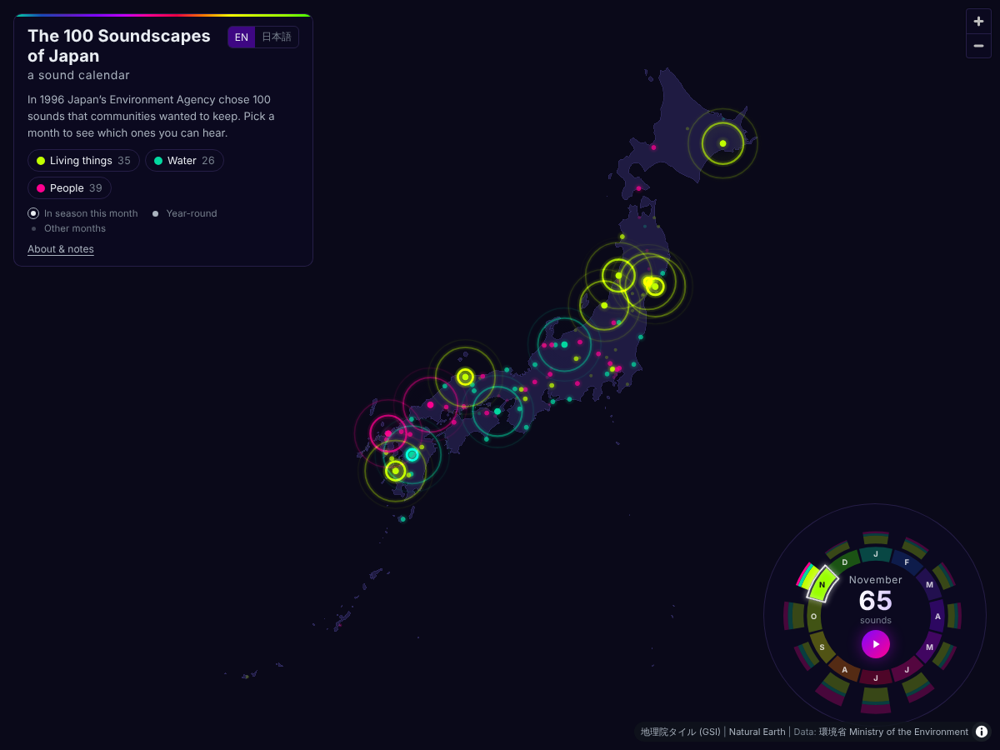

# The 100 Soundscapes of Japan: a sound calendar

**日本の音風景100選 音の暦**

#30DayMapChallenge 2026 · Day 11 · Senses: Sound

**Live map:** https://shinyanakashima.github.io/30daymapchallenge-2026day11-100soundscapes/

On 1 July 1996, Japan's Environment Agency (now the Ministry of the Environment) selected the *100 Soundscapes of Japan* from 738 entries: sounds that local people value and want to pass on, from drift ice and temple bells to frogs, festivals and steam trains. 2026 marks 30 years since the selection.

This map places the 100 sounds and lets you move through the year. Pick a month and the sounds you can hear then pulse with ripples; sounds heard all year stay lit; the rest fade.

- A month dial: twelve months in a ring, January at the top. Click or drag around it to change the month. Bars around the ring show how many seasonal sounds each month has, by type. The play button in the centre runs from January to December; keyboard ← / → (or ↑ / ↓, Home / End on the dial) and Space also work
- Three sound types: **Living things** (birds, insects, frogs, deer, wind in trees), **Water** (waves, falls, rivers, drift ice, singing sand), **People** (bells, festivals, trains, crafts and work)
- Click a point for a photo, its name, place, months and a short description
- English and Japanese (`?lang=ja`); a month can be set with `?month=1`–`12`
- Ripples are drawn on a canvas over the map and stop when the device is set to reduce motion

### Counts

| Type | Items |
|---|---|
| Living things | 35 |
| Water | 26 |
| People | 39 |

Year-round: 53. Seasonal sounds by month (including year-round): highest in July (76), lowest in December (61).

## Data

`data/soundscapes.json` holds one record per soundscape. Field names are generic so the same structure can be reused for similar lists (e.g. the 100 Fragrant Landscapes of Japan).

| Field | Content |
|---|---|
| `id` | Number in the official list (1–100) |
| `name_ja` / `name_en` | Name in Japanese / English |
| `prefecture_ja` / `prefecture_en` | Prefecture |
| `municipality_ja` / `municipality_en` | Municipality (current name after mergers) |
| `lat` / `lon` | Representative point (WGS84) |
| `location_type` | `point` = the site itself, `area` = representative point of a river, coast, wetland, town or route |
| `location_note_ja` | What the point stands for |
| `listening_spot_ja` | Where the pamphlet says the sound is best heard |
| `category` | `living` / `water` / `people` |
| `source_category_ja` | Type given in the official list (鳥, 海, 鐘, 祭りなど …) |
| `months` | Months when the sound can be heard (1–12) |
| `all_year` | `true` if heard all year |
| `months_basis_ja` | Basis for the months, from the pamphlet's "よく聞ける時期" |
| `months_estimated` | `true` if the months were inferred from wording such as "autumn" or "early summer" |
| `description_ja` / `description_en` | Short description written for this map (1–2 sentences) |
| `image` | Freely licensed photo from Wikipedia / Wikimedia Commons: `url`, `source_page`, `file`, `artist`, `license`, `license_url`, `via`, `article_ja` (`null` if none) |

`data/japan-land.geojson` is the land outline of Japan extracted from Natural Earth 1:10m countries. `data/japan-sea-mask.geojson` is its inverse, used to keep the blank-map tiles on land only.

### How the data was made

1. **Names and places**: transcribed from the overview PDF and the pamphlet PDF on the Ministry of the Environment page (list on p.4, entries on pp.5–23).
2. **Months**: read from the "よく聞ける時期" (when best heard) line of each pamphlet entry. Sounds described as daily, weekly or "all year" are year-round. Where only a season was given, it was converted to months and marked as estimated (8 items: No. 13, 14, 15, 54, 63, 79, 98, 100). For No. 14 the kajika frog season was used, although the wild birds can be heard all year.
3. **Coordinates**: the listening spot in the pamphlet was located with the GSI address and place-name search (msearch.gsi.go.jp) and checked against known landmarks. Rivers, coasts, wetlands, towns and railway lines use one representative point (`location_type: area`).
4. **Sound types**: the official categories were grouped into three. Birds, insects, frogs, mammals, plants and mixed wildlife → Living things; sea and inland water → Water; bells, festivals, industry and transport, and daily life → People. Mixed entries were assigned by their main sound.
5. **English names**: based on English Wikipedia "100 Soundscapes of Japan", with some edits for readability.
6. **Descriptions**: written for this map. Photos and text from the pamphlet are not reproduced.
7. **Photos**: the lead image of a related Japanese Wikipedia article (free licences only), replaced with a Wikimedia Commons search result where the lead image was a map, a logo or a different place. 94 of 100 have a photo. Some show the town or the subject (a bird, a festival) rather than the exact listening spot. The photographer and licence are shown under each photo.

## Notes

- The list was selected in 1996. Some sounds may no longer be heard in the same way today.
- Points are representative locations.
- The months are a guide, based on the descriptions in the official pamphlet.

## Sources

- Ministry of the Environment, Japan. 残したい"日本の音風景100選" (overview and pamphlet). https://www.env.go.jp/air/life/nihon_no_oto/index.html
- Wikipedia. 100 Soundscapes of Japan. https://en.wikipedia.org/wiki/100_Soundscapes_of_Japan
- Photos: Wikipedia (ja) and Wikimedia Commons. Each photo is used under the licence shown with it (CC0, CC BY, CC BY-SA, public domain and others); see `image` in `data/soundscapes.json`.
- Base map: 地理院タイル 白地図 (GSI Tiles, blank map), Geospatial Information Authority of Japan. https://maps.gsi.go.jp/development/ichiran.html
- Base map: Natural Earth (public domain), via world-atlas 2.0.2. https://www.naturalearthdata.com/
- Map library: MapLibre GL JS 4.7.1
- Colour palette: taken from the [Mapterhorn](https://mapterhorn.com/) logo

---

## 日本語

1996年7月1日、環境庁（現・環境省）は全国738件の応募から「残したい日本の音風景100選」を選びました。2026年で30年になります。
この地図では100の音を地図に置き、月を切り替えると、その月に聞ける音が波紋で脈打ちます。通年の音は常に表示し、ほかの月の音は薄くなります。

- 月のダイヤル：12か月を円に並べ、1月を真上に置いています。クリックかドラッグで月を切り替えます。外側の棒は、月ごとの季節の音の数を種類別に積み上げたものです。中央の再生ボタンで1月から12月まで自動で進みます。キーボード（← / →、スペースで再生）にも対応しています
- 音の種類：生き物（鳥・虫・蛙・鹿・木々の音）／水（波・滝・川・流氷・鳴き砂）／人の営み（鐘・祭り・乗り物・仕事の音）
- 地点をクリックすると写真、名称、場所、聞ける月、短い説明を表示
- 英語と日本語の切り替え（`?lang=ja`）
- 「動きを減らす」設定の端末では波紋のアニメーションを止めます

### データの作り方

1. 環境省のページにある概要PDFとパンフレットPDFから、名称・所在地・よく聞ける時期・よく聞けるところを書き起こしました。
2. 聞ける月は、パンフレットの「よく聞ける時期」から決めました。「毎日」「1年をとおして」などは通年です。「秋」「初夏から初冬」など季節だけの記述は月に読み替え、「推定」としました（8件）。
3. 緯度経度は、「よく聞けるところ」を国土地理院の地名・住所検索で探して決めました。川・海岸・湿原・町並み・鉄道区間などは代表点です。
4. 音の種類は100選の分類（鳥、昆虫、海、陸水、鐘、祭りなど）を3つにまとめました。複合のものは主な音で分けています。
5. 説明文はこの地図のために書いた要約で、パンフレットの写真や文章は転載していません。
6. 写真は、関連する日本語版Wikipedia記事の代表画像（自由ライセンスのみ）を使い、地図やロゴ、別の場所の画像だった場合はWikimedia Commonsで探して差し替えました（100件中94件）。作者とライセンスは写真の下に表示しています。

### 注記

- 100選は1996年の選定で、今も同じように聞けるとは限りません。
- 地点は代表点です。
- 聞ける月は、説明文などから判断した目安です。

### 出典

- 環境省「残したい“日本の音風景100選”」（概要・パンフレット）
- 背景地図：地理院タイル（白地図）、Natural Earth
- 写真：Wikipedia（日本語版）・Wikimedia Commons（各写真に記載のライセンス）
- 配色：[Mapterhorn](https://mapterhorn.com/) のロゴの色

## License

Code: MIT. Data compiled from the sources above; descriptions in `data/soundscapes.json` are original summaries.
